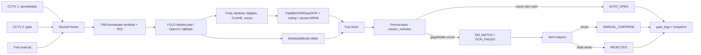

# Tugas Pengolahan Citra Digital: Smart Gate System

**Mata kuliah:** Pengolahan Citra Digital
**Sistem:** Prototype akses gerbang berbasis plat nomor dan stiker
**Status:** Implementasi dan evaluasi bertahap

## 1. Latar Belakang

Smart Gate System mengidentifikasi kendaraan tanpa kontak fisik. CCTV 1
menangkap kendaraan pada zona pendekatan, sedangkan CCTV 2 menangkap kendaraan
di dekat gate. Kedua sumber dapat menghasilkan lebih dari satu gambar untuk
diproses bersama. Plat nomor dibaca dengan OCR dan stiker khusus digunakan
sebagai bukti tambahan.

Jika plat/stiker cocok dengan database kendaraan aktif dan confidence memenuhi
aturan, sistem menghasilkan `AUTO_OPEN`. Jika plat gagal dibaca atau tidak
cocok, sistem menghasilkan `NO_MATCH` atau `OCR_FAILED`, memberi alert kepada
satpam, dan tidak membuka gate otomatis. Satpam dapat memilih `MANUAL_OVERRIDE`
setelah pemeriksaan visual; foto, pengguna, waktu, dan alasan tetap dicatat.

## 2. Tujuan

1. Mendeteksi area plat nomor pada gambar kendaraan.
2. Meningkatkan kualitas crop yang terkena noise, blur, dan pantulan cahaya.
3. Menerjemahkan karakter plat Indonesia dengan OCR dan validasi struktur NRKB.
4. Memilih kendaraan paling dekat ketika satu frame berisi beberapa kendaraan.
5. Menghasilkan keputusan gate yang fail-safe dan audit log lengkap.
6. Membandingkan hasil training detektor dengan hasil OCR end-to-end.

## 3. Arsitektur Sistem



Prototype Flask menyediakan halaman `/camera` untuk mengaktifkan webcam,
menjalankan scan manual/otomatis, dan menampilkan overlay runtime. ROI
berwarna cyan, kotak plat hijau, kotak stiker oranye, serta teks hasil OCR
dapat dilihat langsung. Preview menggunakan `persist=0` agar auto-scan tidak
membanjiri log.

## 4. Dataset dan Pelabelan

Dataset utama berada di `prototype/dataset_merged`:

- train: 1.572 gambar;
- valid: 290 gambar;
- test: 84 gambar;
- satu kelas: `number-plate`.

Sumbernya adalah dataset YOLO `plat-nomor/`, dataset COCO
`datasets/detection/` yang dikonversi, plus set Roboflow "Indonesia License
Plate Detection", dataset Kaggle (COCO), dan latar tanpa plat dari
`no-plate-backgrounds.zip`. Penggabungan Colab memakai prefix `rf_`, `kg_`,
dan `bg_`; data latar hanya masuk split train dan split valid/test dijaga
steril dari train (anti-leakage). Dataset OCR `datasets/text/` digunakan
untuk crop dengan label teks. Data tambahan Wikimedia Commons berjumlah
sekitar 13 positif dan 2 negatif pada pengambilan terakhir; sumber dan lisensi
dicatat di `dataset_extra/SOURCES.md`.

Label positif adalah gambar dengan plat yang benar-benar terlihat dan dapat
diverifikasi. Label negatif adalah gambar bukan plat atau gambar yang
dideteksi sebagai false positive. Data internet ditinjau manual dan tidak
dianggap ground truth hanya karena diunduh otomatis.

## 5. Tahapan Pengolahan Citra

### 5.1 Seleksi spasial dan multi-kendaraan

Untuk webcam, input detector dibatasi ke ROI bawah frame secara default
(`x=5--95%`, `y=35--100%`) agar jaket/wajah di bagian atas tidak menjadi
false positive. ROI dapat dikalibrasi melalui `SGS_DETECTION_ROI`. Sebelum
deteksi, frame diberi koreksi gamma ringan (`SGS_DETECTION_GAMMA`, default
1,15; nilai lebih besar menggelapkan highlight) dan CLAHE terbatas. Frame asli
tetap dipakai untuk audit dan OCR.

Deteksi yang berada di luar ROI gate disaring sebelum OCR. Saat beberapa
kendaraan atau objek mirip plat muncul, urutan kandidat ditentukan
`candidate_score`: kemiripan bentuk plat (skor bingkai `plate_border_score` +
skor struktur `plate_plausibility`) didahulukan, kedekatan ke kamera (luas
bbox + posisi bawah) hanya pemecah seri. Skor bingkai menghukum blob teks/video
(subtitle, thumbnail) yang tidak memiliki bingkai papan plat sehingga distraktor
layar tidak mengambil slot OCR dari plat asli. Kandidat yang menelan kandidat lain
dibuang karena sering berupa gabungan bodi/lampu/logo. Maksimal kandidat terbaik
diteruskan ke OCR untuk menekan latency dan mencegah salah baca kendaraan
belakang. Pada tampilan, hanya kotak kandidat terpilih (`primary`) yang digambar
terang; kandidat sekunder digambar tipis transparan agar tidak "sibuk".

ROI default prototype adalah x 10--90% dan y 25--100%; nilai ini harus
dikalibrasi per kamera. Kandidat tunggal tetap dapat diproses untuk foto manual.

### 5.2 Enhancement dan ketahanan pantulan

Urutan pemrosesan crop dapat mencakup:

1. koreksi perspektif/penyempitan ke pita teks;
2. deteksi highlight dan inpainting `deglare`;
3. grayscale, adaptive threshold, morphology close;
4. CLAHE untuk kontras lokal;
5. median blur 3×3 untuk meredam moiré/pola piksel layar monitor sebelum
   penajaman;
6. upscale 160/240 piksel dan unsharp mask;
7. margin `pad_crop` dikembalikan setelah penyempitan pita teks agar lengan
   huruf (`Y`, `G`, `4`) yang samar tidak terpotong lalu salah baca
   (mis. `Y` terpotong → terbaca `1` → dinormalisasi `I`);
8. retry terbatas (`deglare`, adaptive threshold) sampai hasil valid **dan**
   keyakinan ≥ 0,80 — retry juga dipicu bila hasil valid-struktur tetapi
   keyakinan rendah, karena kesalahan baca akibat moiré sering tetap
   "terlihat seperti plat" (mis. `BB1999OGI`).

Pantulan monitor berbeda dari pantulan kendaraan nyata. Karena itu hasil dari
foto yang menampilkan plat pada layar monitor harus ditandai sebagai kasus
khusus, bukan bukti bahwa sistem sudah stabil untuk semua CCTV.

### 5.3 OCR dan aturan NRKB

Backend prototype memprioritaskan PaddleOCR CPU untuk crop plat kecil/distorsi.
Runtime saat ini masih memakai EasyOCR karena paket `paddleocr` dan
`paddlepaddle` belum terpasang; EasyOCR tetap sebagai fallback kompatibel dan
template matching sebagai fallback terakhir.
PaddleOCR memakai mode recognition pada crop yang sudah dideteksi, allowlist
`0123456789ABCDEFGHIJKLMNOPQRSTUVWXYZ`, warm-up, dan cache crop. Jika hasil
awal rendah, sistem mencoba crop deglare/enhancement lalu melakukan voting
lintas frame. Backend dapat dipilih dengan `SGS_OCR_BACKEND`.
Crop hasil YOLO diberi padding agar karakter suffix seperti `UL` tidak terpotong.
EasyOCR juga memakai `paragraph`, `width_ths`, dan `link_threshold` agar jarak
antara nomor dan suffix tetap digabung.

Struktur yang divalidasi:

- prefix wilayah 1--3 huruf;
- nomor urut 1--4 angka, tidak diawali angka `0`;
- suffix 0--3 huruf;
- karakter ambigu dikoreksi berdasarkan posisi, bukan penggantian global:
  `B/8`, `6/G`, `1/I`, `O/0`, `I/1`, `L/1`, `S/5`, `T/7`, `A/4`, `D/0`, `V/U`, `W/VV`, `X/XX`, `Z/2`;
- koreksi blok prefix (V4 parser): `0/1/O/I/L` → `D`, `8` → `B`, dengan bonus
  skor untuk kode wilayah valid (`VALID_PREFIXES`) sehingga plat Makassar yang
  terbaca `005877US` dikoreksi menjadi `DD5877US`; blok angka diawali `0`
  dikenai penalti karena NRKB tidak pernah diawali `0`.

Aturan di atas bukan sekadar pemeringkat: hasil OCR yang melanggar struktur
NRKB **ditolak keras** dan dianggap tidak terbaca (teks mentah tetap disimpan
di `plate_raw_text` untuk audit), confidence tidak ikut dihitung ke skor fusi,
dan alasan `OCR_FAILED` menjelaskan pelanggaran format. Voting antar-frame juga
membuang suara yang melanggar struktur sebelum penghitungan suara.

Rentang nomor kendaraan (1--1999 mobil penumpang, 2000--6999 sepeda motor,
7000--7999 bus, 8000--8999 barang, 9000--9999 khusus) hanya menjadi petunjuk
tambahan. Sumber referensi: [Bapenda Jawa Barat](https://bapenda.jabarprov.go.id/2017/10/24/kenali-penomoran-kendaraan-bermotor/).

### 5.4 Stiker

Stiker/QR/pola khusus diproses sebagai bukti kedua. Stiker yang sesuai dapat
menambah confidence, tetapi tidak boleh mengabaikan kontrol database dan aturan
fail-safe. Implementasi prototype menyediakan deteksi stiker/fallback; kelas
stiker belum termasuk dalam `dataset_merged` satu kelas. Blok warna jenuh
hasil fallback hanya menjadi bukti bila berhasil didekode — kandidat yang
gagal didekode dibuang agar objek berwarna di latar (mis. video/layar) tidak
berubah menjadi kotak stiker palsu.

## 6. Keputusan Sistem

| Kode | Kondisi | Output |
| --- | --- | --- |
| `AUTO_OPEN` | Plat/stiker valid dan cocok di database | Perintah buka pintu otomatis dan log foto |
| `NO_MATCH` | Teks terbaca tetapi tidak terdaftar | Alert kendaraan tidak dikenali |
| `OCR_FAILED` | Plat dan stiker tidak cukup terbaca | Alert kendaraan tidak dikenali |
| `MANUAL_OVERRIDE` | Satpam memverifikasi aman | Bypass buka manual, wajib audit |
| `REJECTED` | Satpam menilai tidak aman | Gate tetap tertutup, simpan alasan |

Jika database, kamera, atau komponen keputusan gagal, sistem tidak melakukan
`AUTO_OPEN`. Semua keputusan menyimpan snapshot dan metadata audit.

## 7. Training Model

Training detektor dijalankan dengan YOLOv8n detection pada `data.yaml` merged.
Contoh CPU:

```powershell
cd "D:\Project\Smart Gate System\Tugas Citra Digital\prototype"
python train_yolo.py --data dataset_merged/data.yaml --epochs 15 `
  --imgsz 416 --batch 8 --device cpu --patience 5 --name smartgate
```

Training berhenti otomatis melalui dua mekanisme: `patience` (tidak ada
perbaikan mAP50 selama N epoch) dan `--target-map50` (default `0,98`,
nonaktifkan dengan `0`) yang memaksa training berhenti begitu target mAP50
tercapai — callback `on_fit_epoch_end` yang sama dipasang di notebook
`plat-nomor/a.ipynb` (`TARGET_MAP50 = 0.98`) sehingga waktu komputasi
GPU/Colab tidak terbuang untuk epoch yang tidak perlu.

Run **V5 `smartgate-colab-v5`** (Colab, YOLOv8n, 50 epoch, dataset gabungan
Roboflow + Kaggle COCO + background) adalah run aktif dengan hasil terbaik
sejauh ini:

| Metrik | Nilai |
| --- | ---: |
| Validation mAP50 | 0,8938 |
| Validation mAP50-95 | 0,5339 |
| Test mAP50 | 0,9491 |
| Test mAP50-95 | 0,5999 |
| Valid format rate OCR (V4 parser) | 73,95% (88/119 plat) |
| Latency rata-rata / P95 | 98,22 ms / 176,99 ms |

Run awal 15 epoch lokal menghasilkan kira-kira precision 0,714, recall 0,668,
mAP50 0,716, dan mAP50-95 0,435; run `smartgate-full` (4 epoch) berhenti pada
mAP50 sementara 0,6671 — keduanya hanya baseline historis. Halaman
`/training` otomatis menampilkan run dengan `results.csv` paling baru.

Bobot dipasang melalui:

```powershell
$env:SGS_YOLO_WEIGHTS = "D:\Project\Smart Gate System\Tugas Citra Digital\prototype\runs\detect\smartgate-colab-v5\weights\best.pt"
python run.py
```

Tanpa `SGS_YOLO_WEIGHTS`, prototype memakai bobot terbaru secara otomatis
(`smartgate-colab-v5` di urutan pertama). Validasi detektor dan OCR harus
dilaporkan terpisah:

```powershell
yolo val model=runs/detect/smartgate-colab-v5/weights/best.pt `
  data=dataset_merged/data.yaml
python tools/eval_real.py --part both --limit 200
```

## 8. Evaluasi dan Hasil

Metrik detektor: precision, recall, mAP50, dan mAP50-95. Metrik OCR:
plate accuracy, character accuracy/CER, false accept rate, serta latency
p95. Target akademik dapat digunakan sebagai sasaran eksperimen, bukan klaim
hasil sebelum diuji pada dataset terpisah.

Uji manual yang sudah dicakup meliputi normalisasi NRKB, pemilihan kandidat
terdekat, ROI, voting OCR, retry enhancement, fusi, dan alur end-to-end.
Regresi otomatis terkunci di `tests/test_pipeline.py` (assert tanpa framework,
80+ pemeriksaan): aturan NRKB, voting, moiré monitor (`test_monitor_moire`),
dan distraktor layar/video (`test_distractors`).
Kasus seperti `L1257PR` berhasil dibantu penyempitan pita teks dan voting.
Kasus pantulan layar seperti `AA5045YN` masih tidak stabil karena detektor
klasik dapat memecah plat menjadi fragmen.

Untuk pantulan monitor, `SGS_CLAHE_CLIP_LIMIT` dapat diturunkan agar pola moire
tidak terlalu diperkuat. Beberapa frame dari kendaraan yang sama dinormalisasi
lebih dahulu, kemudian hasil mayoritas dipilih. Jika plat dan stiker mengarah
ke dua kendaraan berbeda, hasil tersebut ditolak sebagai konflik bukti dan
tidak boleh `AUTO_OPEN`.

## 9. Keterbatasan dan Pengembangan

- YOLO harus menjadi detector utama pada deployment; OpenCV klasik adalah
  fallback dan lebih sensitif terhadap background terang.
- ROI dan ambang ukuran perlu konfigurasi per gate.
- Foto kendaraan langsung lebih representatif daripada foto layar monitor.
- Tracking antar-frame (ByteTrack/DeepSORT) belum diimplementasikan.
- Training OCR khusus karakter Indonesia masih merupakan pengembangan; saat ini
  sistem menggunakan recognizer pretrained, enhancement, voting, dan aturan
  NRKB.
- Data gagal yang telah dikonfirmasi satpam sebaiknya dianonimkan, diberi label,
  lalu dimasukkan ke evaluasi berikutnya.

## 10. Kesimpulan

Pipeline menghasilkan keluaran sampai perintah buka pintu, kendaraan tidak
dikenali, bypass satpam, atau penolakan. Kombinasi dua CCTV, seleksi kendaraan
terdekat, deglare, OCR retry, aturan NRKB, database, dan audit snapshot
mengurangi risiko salah baca dan salah buka. Validasi produksi tetap memerlukan
rekaman CCTV nyata yang mencakup siang, malam, hujan, pantulan, dan kendaraan
tidak terdaftar.

## Referensi

1. Ultralytics, dokumentasi YOLO.
2. PaddleOCR, dokumentasi dan model recognizer (EasyOCR tetap didukung sebagai opsi).
3. Bapenda Jawa Barat, [Kenali Penomoran Kendaraan Bermotor](https://bapenda.jabarprov.go.id/2017/10/24/kenali-penomoran-kendaraan-bermotor/).
4. [`TRAINING_GUIDE.md`](prototype/TRAINING_GUIDE.md).
5. Dokumentasi sistem: [`docs/PRD.md`](../docs/PRD.md), [`docs/SYSTEM_FLOW.md`](../docs/SYSTEM_FLOW.md), [`docs/DATABASE.md`](../docs/DATABASE.md), [`docs/API.md`](../docs/API.md), dan [`docs/TECHNICAL.md`](../docs/TECHNICAL.md).
