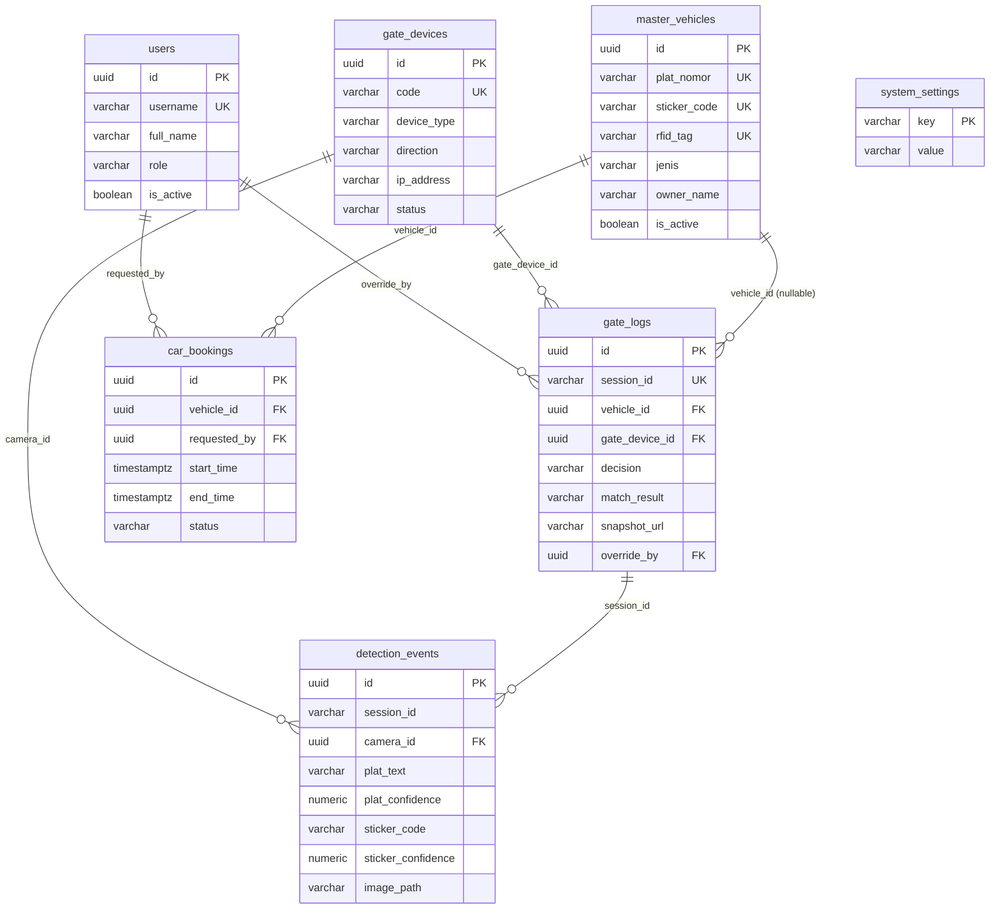

# Database & Relasi — Enterprise Smart Gate System

> **Catatan lingkup:** Fitur stiker QR dan RFID dalam dokumen ini adalah
> **rencana pengembangan mendatang / bahan skripsi**. Lingkup prototipe saat ini:
> pengenalan plat nomor (YOLOv8 + aturan NRKB + keputusan fail-safe).

Referensi: [PRD.md](PRD.md) · [SYSTEM_FLOW.md](SYSTEM_FLOW.md) · [API.md](API.md) · [TECHNICAL.md](TECHNICAL.md)

DBMS: **PostgreSQL 16** (+ ekstensi `pgcrypto` untuk `gen_random_uuid()`, `pg_trgm` untuk pencarian plat mirip).

---

## 1. ERD



---

## 2. DDL

```sql
CREATE EXTENSION IF NOT EXISTS pgcrypto;
CREATE EXTENSION IF NOT EXISTS pg_trgm;

-- ============ ENUM ============
CREATE TYPE user_role       AS ENUM ('SATPAM', 'ADMIN', 'SUPERVISOR');
CREATE TYPE device_type     AS ENUM ('CCTV_APPROACH', 'CCTV_GATE', 'GATE_MOTOR', 'RFID_READER');
CREATE TYPE device_dir      AS ENUM ('IN', 'OUT', 'BOTH');
CREATE TYPE device_status   AS ENUM ('ONLINE', 'OFFLINE', 'MAINTENANCE');
CREATE TYPE vehicle_jenis   AS ENUM ('WARGA', 'KARYAWAN', 'OPERASIONAL', 'TAMU');
CREATE TYPE booking_status  AS ENUM ('PENDING', 'APPROVED', 'ACTIVE', 'COMPLETED', 'CANCELLED');
CREATE TYPE match_result    AS ENUM ('MATCH', 'NO_MATCH', 'LOW_CONFIDENCE', 'OCR_FAILED');
CREATE TYPE gate_decision   AS ENUM ('AUTO_OPEN', 'MANUAL_OVERRIDE', 'REJECTED');

-- ============ USERS ============
CREATE TABLE users (
    id            UUID PRIMARY KEY DEFAULT gen_random_uuid(),
    username      VARCHAR(64)  NOT NULL UNIQUE,
    password_hash VARCHAR(255) NOT NULL,   -- prototipe: PBKDF2-HMAC-SHA256 (lihat app/auth.py)
    full_name     VARCHAR(128) NOT NULL,
    role          user_role    NOT NULL DEFAULT 'SATPAM',
    is_active     BOOLEAN      NOT NULL DEFAULT TRUE,
    created_at    TIMESTAMPTZ  NOT NULL DEFAULT now(),
    updated_at    TIMESTAMPTZ  NOT NULL DEFAULT now()
);

-- ============ GATE DEVICES ============
CREATE TABLE gate_devices (
    id          UUID PRIMARY KEY DEFAULT gen_random_uuid(),
    code        VARCHAR(64)  NOT NULL UNIQUE,   -- 'cam_gate_masuk_1', 'gate_in_motor'
    name        VARCHAR(128) NOT NULL,
    device_type device_type  NOT NULL,
    direction   device_dir   NOT NULL DEFAULT 'BOTH',
    ip_address  INET,
    mqtt_topic  VARCHAR(128),
    status      device_status NOT NULL DEFAULT 'OFFLINE',
    last_seen_at TIMESTAMPTZ,
    created_at  TIMESTAMPTZ  NOT NULL DEFAULT now()
);

-- ============ MASTER VEHICLES ============
CREATE TABLE master_vehicles (
    id           UUID PRIMARY KEY DEFAULT gen_random_uuid(),
    plat_nomor   VARCHAR(16)  NOT NULL UNIQUE,   -- disimpan UPPERCASE tanpa spasi
    sticker_code VARCHAR(64)  UNIQUE,            -- stiker khusus warga/karyawan
    rfid_tag     VARCHAR(64)  UNIQUE,            -- opsional
    jenis        vehicle_jenis NOT NULL DEFAULT 'TAMU',
    owner_name   VARCHAR(128),
    owner_dept   VARCHAR(128),
    phone        VARCHAR(32),
    is_active    BOOLEAN      NOT NULL DEFAULT TRUE,
    created_at   TIMESTAMPTZ  NOT NULL DEFAULT now(),
    updated_at   TIMESTAMPTZ  NOT NULL DEFAULT now()
);

-- ============ CAR BOOKINGS ============
CREATE TABLE car_bookings (
    id           UUID PRIMARY KEY DEFAULT gen_random_uuid(),
    vehicle_id   UUID NOT NULL REFERENCES master_vehicles(id) ON DELETE RESTRICT,
    requested_by UUID REFERENCES users(id) ON DELETE SET NULL,
    purpose      VARCHAR(255),
    start_time   TIMESTAMPTZ NOT NULL,
    end_time     TIMESTAMPTZ NOT NULL,
    status       booking_status NOT NULL DEFAULT 'APPROVED',
    created_at   TIMESTAMPTZ NOT NULL DEFAULT now(),
    CONSTRAINT chk_booking_range CHECK (end_time > start_time)
);

-- ============ DETECTION EVENTS (raw per frame/gambar) ============
CREATE TABLE detection_events (
    id                 UUID PRIMARY KEY DEFAULT gen_random_uuid(),
    session_id         VARCHAR(64) NOT NULL,     -- korelasi CCTV 1 + CCTV 2
    camera_id          UUID NOT NULL REFERENCES gate_devices(id) ON DELETE RESTRICT,
    direction          device_dir NOT NULL DEFAULT 'IN',
    plat_text          VARCHAR(32),
    plat_confidence    NUMERIC(5,4) CHECK (plat_confidence BETWEEN 0 AND 1),
    sticker_code       VARCHAR(64),
    sticker_confidence NUMERIC(5,4) CHECK (sticker_confidence BETWEEN 0 AND 1),
    is_best_frame      BOOLEAN NOT NULL DEFAULT FALSE,
    image_path         VARCHAR(512) NOT NULL,    -- path di NAS
    captured_at        TIMESTAMPTZ NOT NULL,
    created_at         TIMESTAMPTZ NOT NULL DEFAULT now()
);

-- ============ GATE LOGS (hasil akhir per sesi) ============
CREATE TABLE gate_logs (
    id                 UUID PRIMARY KEY DEFAULT gen_random_uuid(),
    session_id         VARCHAR(64) NOT NULL UNIQUE,
    vehicle_id         UUID REFERENCES master_vehicles(id) ON DELETE SET NULL,  -- NULL = tidak dikenal
    gate_device_id     UUID REFERENCES gate_devices(id) ON DELETE SET NULL,
    booking_id         UUID REFERENCES car_bookings(id) ON DELETE SET NULL,
    direction          device_dir NOT NULL DEFAULT 'IN',
    plate_final        VARCHAR(32),
    plate_confidence   NUMERIC(5,4),
    sticker_final      VARCHAR(64),
    sticker_confidence NUMERIC(5,4),
    match_result       match_result NOT NULL,
    decision           gate_decision NOT NULL,
    snapshot_url       VARCHAR(512) NOT NULL,     -- best frame
    snapshot_urls      JSONB NOT NULL DEFAULT '[]'::jsonb, -- semua CCTV di sesi
    override_by        UUID REFERENCES users(id) ON DELETE SET NULL,
    override_note      TEXT,
    override_at        TIMESTAMPTZ,
    created_at         TIMESTAMPTZ NOT NULL DEFAULT now(),
    -- audit: bypass wajib punya pelaku + catatan
    CONSTRAINT chk_override_required CHECK (
        decision <> 'MANUAL_OVERRIDE' OR (override_by IS NOT NULL AND override_note IS NOT NULL)
    )
);

-- ============ SYSTEM SETTINGS ============
CREATE TABLE system_settings (
    key         VARCHAR(64) PRIMARY KEY,
    value       TEXT NOT NULL,
    description VARCHAR(255),
    updated_at  TIMESTAMPTZ NOT NULL DEFAULT now()
);
```

---

## 3. Indeks

```sql
CREATE INDEX idx_events_session        ON detection_events(session_id);
CREATE INDEX idx_events_captured       ON detection_events(captured_at DESC);
CREATE INDEX idx_events_best_frame     ON detection_events(session_id) WHERE is_best_frame;

CREATE INDEX idx_logs_created          ON gate_logs(created_at DESC);
CREATE INDEX idx_logs_decision         ON gate_logs(decision);
CREATE INDEX idx_logs_vehicle          ON gate_logs(vehicle_id);
CREATE INDEX idx_logs_match_result     ON gate_logs(match_result);
CREATE INDEX idx_logs_override_by      ON gate_logs(override_by);

CREATE INDEX idx_booking_vehicle_time  ON car_bookings(vehicle_id, start_time, end_time);
CREATE INDEX idx_booking_active        ON car_bookings(status, start_time, end_time);

-- pencarian plat toleran typo OCR (mis. B1234XYZ vs 81234XYZ)
CREATE INDEX idx_vehicles_plat_trgm    ON master_vehicles USING gin (plat_nomor gin_trgm_ops);
```

---

## 4. Query Kunci

### 4.1 Pencocokan kendaraan (plat ATAU stiker)

```sql
SELECT id, plat_nomor, sticker_code, jenis, owner_name, is_active
FROM master_vehicles
WHERE is_active
  AND (plat_nomor = $1 OR sticker_code = $2)
LIMIT 1;
```

### 4.2 Fallback pencarian plat mirip (hanya bila confidence sedang)

```sql
SELECT id, plat_nomor, similarity(plat_nomor, $1) AS sim
FROM master_vehicles
WHERE is_active AND plat_nomor % $1
ORDER BY sim DESC
LIMIT 3;
```

### 4.3 Cek booking aktif pada saat kejadian

```sql
SELECT id
FROM car_bookings
WHERE vehicle_id = $1
  AND status IN ('APPROVED', 'ACTIVE')
  AND $2 BETWEEN start_time AND end_time
LIMIT 1;
```

### 4.4 Ambil seluruh gambar satu sesi

```sql
SELECT e.camera_id, g.code, e.plat_text, e.plat_confidence,
       e.sticker_code, e.sticker_confidence, e.image_path, e.captured_at
FROM detection_events e
JOIN gate_devices g ON g.id = e.camera_id
WHERE e.session_id = $1
ORDER BY e.captured_at;
```

### 4.5 Rekap harian

```sql
SELECT decision, match_result, COUNT(*) AS total
FROM gate_logs
WHERE created_at >= CURRENT_DATE
GROUP BY decision, match_result
ORDER BY total DESC;
```

---

## 5. Data Awal (Seed)

```sql
INSERT INTO system_settings (key, value, description) VALUES
  ('plat_confidence_threshold',     '0.85', 'Ambang minimum confidence plat untuk auto match'),
  ('sticker_confidence_threshold',  '0.80', 'Ambang minimum confidence stiker untuk auto match'),
  ('fused_confidence_threshold',    '0.90', 'Ambang skor fusi untuk AUTO_OPEN tanpa booking'),
  ('session_window_seconds',        '3',    'Jendela korelasi gambar antar CCTV dalam satu sesi'),
  ('min_images_per_session',        '2',    'Minimum jumlah gambar (dari 2 CCTV) sebelum evaluasi'),
  ('require_booking_for_operational','true','Kendaraan operasional wajib punya booking aktif'),
  ('snapshot_retention_days',       '90',   'Retensi file snapshot di NAS'),
  ('log_retention_days',            '365',  'Retensi baris gate_logs');

INSERT INTO gate_devices (code, name, device_type, direction, mqtt_topic) VALUES
  ('cam_gate_masuk_1', 'CCTV 1 - Pendekatan Masuk', 'CCTV_APPROACH', 'IN',  NULL),
  ('cam_gate_masuk_2', 'CCTV 2 - Gate Masuk',       'CCTV_GATE',     'IN',  NULL),
  ('gate_in_motor',    'Motor Gate Masuk',          'GATE_MOTOR',    'IN',  'gate/in/motor/cmd');
```

---

## 6. Retensi & Backup

| Data | Retensi | Aksi |
| :--- | :--- | :--- |
| `detection_events` | 90 hari | `DELETE` harian via pg_cron |
| `gate_logs` | 365 hari | Arsip ke tabel `gate_logs_archive`, lalu `DELETE` |
| File snapshot di NAS | 90 hari | Pembersihan oleh job `snapshot-cleanup` |
| Backup PostgreSQL | Harian | `pg_dump` ke NAS, retensi 30 hari |

```sql
-- contoh job harian
DELETE FROM detection_events WHERE captured_at < now() - INTERVAL '90 days';
DELETE FROM gate_logs        WHERE created_at  < now() - INTERVAL '365 days';
```

---

## 7. Catatan Integritas

- `chk_override_required` menjamin setiap bypass menyertakan pelaku dan alasan — inilah bukti audit yang tidak dapat dilewati aplikasi.
- `gate_logs.vehicle_id` sengaja `NULLABLE`; `NULL` berarti **kendaraan tidak dikenal** dan pasangan yang sah adalah `match_result = 'NO_MATCH'`.
- Normalisasi `plat_nomor` dilakukan di aplikasi: uppercase, hapus spasi/tanda hubung — sebelum `INSERT` maupun `SELECT`.
- `session_id` disimpan sebagai `VARCHAR(64)` (bukan UUID khusus) agar AI worker bebas memakai format apa pun asalkan unik per kendaraan-lewat.
