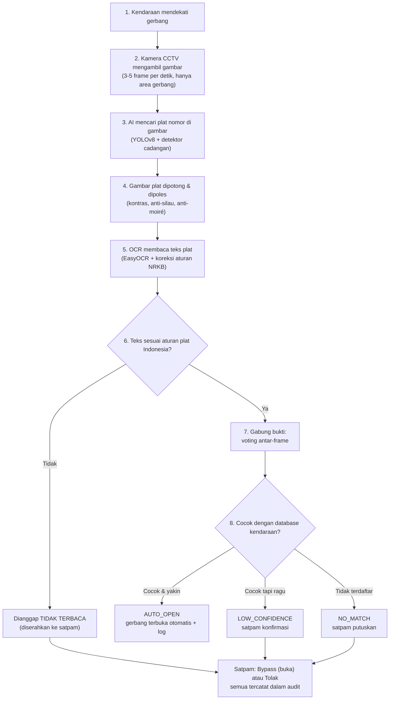

# Smart Gate System — Bahan Presentasi

> Dari awal sampai akhir: bagaimana satu kendaraan dikenali, diputuskan, dan
> dicatat — dalam bahasa yang mudah dipahami.
> Pendamping teknis: [TECHNICAL](TECHNICAL.md) · [SYSTEM_FLOW](SYSTEM_FLOW.md) ·
> panduan training: [TRAINING_GUIDE](../Tugas%20Citra%20Digital/prototype/TRAINING_GUIDE.md)

---

## 1. Ringkasan (Slide Pembuka)

**Masalah:** Petugas gerbang mencatat plat kendaraan secara manual — lambat,
rawan salah catat, dan tidak ada jejak audit.

**Solusi:** Sistem membaca plat nomor otomatis dari kamera (AI deteksi + OCR),
mencocokkannya dengan database kendaraan, lalu membuka gerbang otomatis —
dengan satpam tetap memegang kendali penuh.

**Hasil:** Akurasi deteksi Test mAP50 **94,91%**, rata-rata waktu proses
**98 ms per frame**, dan seluruh keputusan tercatat dalam log audit.

**Prinsip utama:** *sistem tidak pernah membuka gerbang bila ragu* (fail-safe).

---

## 2. Alur dari Awal ke Akhir

---

## 3. Penjelasan Tiap Tahap

### Tahap 1–2 — Ambil Gambar
Kamera CCTV tidak memproses semua frame (25–30 fps) — cukup **3–5 frame per
detik**. Manusia tidak akan sadar, tetapi beban CPU turun drastis. Pencarian
plat juga dibatasi ke **zona gerbang** (ROI) — langit, pohon, dan layar di
luar zona tidak ikut diproses.

### Tahap 3 — Cari Plat
Model **YOLOv8n (Nano)** — varian teringan — menemukan kotak plat. Bila model
ragu, detektor klasik OpenCV menjadi cadangan. Kandidat dinilai dari
**kemiripannya dengan papan plat** (ada bingkai gelap, struktur huruf/angka),
bukan sekadar "objek yang mirip teks". Inilah yang menahan distraktor seperti
subtitle video atau thumbnail YouTube.

### Tahap 4 — poles Gambar Plat
Hanya kotak kecil plat yang dipoles — bukan seluruh frame:
**CLAHE** (kontras), **bilateral filter** (haluskan noise), **median blur**
(meredam moiré layar monitor), dan margin tepi dijaga agar lengan huruf tidak
terpotong. Karena hanya crop kecil yang diproses, waktunya 1–2 ms.

### Tahap 5 — Baca Teks (OCR) & Aturan NRKB
EasyOCR membaca karakter; lalu **aturan plat Indonesia (NRKB)** ditegakkan:

| Aturan | Contoh |
| --- | --- |
| Bagian depan = kode wilayah, wajib **huruf** | `B`, `DD`, `AA` — bukan angka |
| Nomor urut **tidak pernah diawali `0`** | `B 1234 XY` sah, `B 0123 XY` tidak |
| Urutan blok: huruf → angka → huruf | `DD 5678 XY` |
| Golongan nomor = jenis kendaraan | 1–1999 mobil, 2000–6999 motor |

Hasil yang melanggar aturan **ditolak keras** — dianggap tidak terbaca,
bukan ditampilkan seadanya. Lebih baik "tidak terbaca" (satpam yang cek)
daripada salah baca yang membuka gerbang untuk kendaraan yang salah.

### Tahap 6–8 — Keputusan
Beberapa frame di-*vote* (mayoritas menang) untuk menguatkan bacaan, lalu
dicocokkan ke database. Hanya bila **identitas jelas, keyakinan tinggi, dan data
cocok** gerbang membuka sendiri. Selain itu, satpam yang memutuskan.

---

## 4. Tabel Keputusan (Ringkas)

| Situasi | Keputusan | Aksi |
| --- | --- | --- |
| Plat valid, conf ≥ 0,85, terdaftar | **AUTO_OPEN** | Gerbang buka otomatis |
| Plat valid tapi conf rendah | **LOW_CONFIDENCE** | Satpam konfirmasi |
| Terbaca tapi tidak terdaftar | **NO_MATCH** | Satpam putuskan |
| Gagal baca / melanggar format | **OCR_FAILED** | Satpam putuskan |
| Satpam menilai aman | **MANUAL_OVERRIDE** | Buka manual + catat identitas satpam |
| Satpam menolak | **REJECTED** | Gerbang tetap tertutup + alasan |
| Database/kamera bermasalah | **tidak pernah AUTO_OPEN** | Fail-safe ke satpam |

---

## 5. Kenapa Ringan di Hardware Seadanya

| Trik | Efek |
| --- | --- |
| CLAHE hanya pada **crop plat**, bukan frame penuh | Ratusan ms → 1–2 ms |
| **Frame skipping** 3–5 fps + batasi zona ROI | CPU tidak memproses 30 fps |
| YOLOv8**n** + ekspor **ONNX** | Model teringan, inferensi cepat di CPU |
| **Early stopping** (`patience` + callback target 98%) | Training berhenti saat cukup — hemat GPU |
| Cache hasil baca per frame sama | Auto scan tidak mengulang OCR |
| Retry berat hanya saat gagal | Jalur normal tetap cepat |

---

## 6. Hasil & Kejujuran Angka

| Metrik | Nilai |
| --- | ---: |
| Validation mAP50 | 89,38% |
| **Test mAP50** | **94,91%** |
| Latency rata-rata / P95 | 98,22 ms / 176,99 ms |
| Format plat terbaca benar | 73,95% (88/119) |

**Target 98% belum tercapai — dan itu disampaikan apa adanya.** Pelatihan
berhenti wajar di epoch 50 tanpa overfitting ekstrem; menambah epoch tidak akan
mengejar sisa target. Jalannya adalah **data-centric**: menambah variasi dataset
kondisi ekstrem (kemiringan tinggi, pantulan cahaya, plat kusam) — bukan
memperbanyak iterasi.

---

## 7. Prinsip Keamanan (Fail-Safe)

1. **Ragu = tidak buka.** Seluruh komponen kritis bermasalah → keputusan
   jatuh ke satpam, gerbang tidak pernah terbuka otomatis.
2. **Salah baca lebih berbahaya daripada tidak terbaca.** Hasil melanggar
   aturan NRKB dibuang, bukan ditampilkan.
3. **Semua tercatat.** Setiap keputusan menyimpan foto + metadata; bypass
   satpam wajib beralasan dan teraudit.
4. **Satpam memegang kendali akhir** — bypass dan penolakan selalu tersedia.

---

## 8. FAQ — Pertanyaan yang Sering Muncul

**Q: Kenapa tidak pakai Template Matching saja (lebih ringan)?**
Template matching statis — hancur menghadapi kemiringan, beda skala, dan font
tidak standar. Dipakai hanya sebagai **cadangan terakhir** bila OCR gagal.

**Q: Kenapa epoch tidak dinaikkan sampai akurasi 98%?**
Justru memicu *overfitting* — model menghafal data latih, lalu bingung pada
kondisi nyata. Solusinya penambahan variasi data (data-centric), bukan iterasi.

**Q: Bagaimana bila ada dua kendaraan sekaligus?**
Gerbang adalah serialisasi fisik — satu kendaraan melewati satu titik. Sistem
membuang kandidat di luar zona gerbang dan memilih plat paling meyakinkan.
Pelacakan multi-kendaraan penuh (ByteTrack/DeepSORT) adalah pengembangan lanjut.

**Q: Kalau plat difoto di layar monitor, bagaimana?**
Diuji lebih dulu sebagai kasus terberat pantulan/moiré. Median blur + retry
berbasis keyakinan menanganinya; untuk layar, hasil moiré parah tetap lebih
aman diserahkan ke satpam.

**Q: Kenapa kadang muncul "tidak terbaca" padahal jelas?**
Itu gerbang aturan NRKB bekerja. Citra kegagalan otomatis tersimpan untuk
diagnosis — jadi kasus tersebut jadi bahan perbaikan model, bukan kegagalan
diam-diam.

**Q: Berapa biaya komputasinya?**
Jalan di PC standar (tanpa GPU khusus): rata-rata 98 ms per frame. Seluruh
optimasi (crop-only CLAHE, frame skipping, ONNX) hadir agar target ini tercapai.

**Q: Kenapa YOLOv11n, bukan yang paling besar (v8x)?**
Kami membandingkan tiga arsitektur pada dataset dan konfigurasi yang sama:
YOLOv8n, YOLOv8x, dan YOLOv11n. Hasilnya, YOLOv11n (paling ringan, 5,5 MB)
justru unggul keseluruhan — Test mAP50 0,9683, valid-format OCR 75%, latensi
setara v8n. YOLOv8x unggul tipis di deteksi atas v8n tetapi OCR-nya paling
tidak stabil dan 2× lebih lambat. Konsisten dengan Ramadhani dkk. (2026):
akurasi deteksi tidak otomatis berarti akurasi OCR lebih baik. Ketiganya bisa
dibandingkan langsung di aplikasi lewat pemilih model di `/training`.

---

## 9. Rencana Pengembangan / Bahan Skripsi

Di luar lingkup prototipe saat ini — kode dan materinya sudah disiapkan:

1. **Stiker QR bertanda tangan** — bukti kendaraan kedua (implementasi tersedia
   sebagai fondasi, nonaktif dari lingkup utama).
2. **Integrasi RFID + mikrokontroler (ESP32)** — buka gerbang via kartu, kontrol
   relay langsung dari sistem.
3. **Recognizer OCR khusus font TNKB** — data latih sudah tersedia:
   `dataset_extra/ocr_reference/plate_text_dataset` + glyph `alpr`.
4. **Pelacakan multi-kendaraan (ByteTrack/DeepSORT)** untuk antrean.
5. **Active learning** dari citra gagal terbaca (`ocr_failed/`) untuk
   pelatihan ulang berkala.

---

## 10. Penutup

Smart Gate System membuktikan bahwa pengenalan plat nomor yang **cepat, akurat,
dan aman** bisa dibangun dengan hardware seadanya: AI mengerjakan pekerjaan
berulang, satpam memegang keputusan penting, dan setiap tindakan tercatat.
