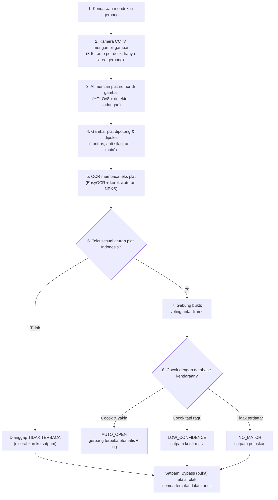

# Smart Gate System — Bahan Presentasi

> Dari awal sampai akhir: bagaimana satu kendaraan dikenali, diputuskan, dan
> dicatat — dalam bahasa yang mudah dipahami.
> Pendamping teknis: [TECHNICAL](TECHNICAL.md) · [SYSTEM_FLOW](SYSTEM_FLOW.md) ·
> panduan training: [TRAINING_GUIDE](TRAINING_GUIDE.md)

---

## 1. Ringkasan (Slide Pembuka)

**Masalah:** Petugas gerbang mencatat plat kendaraan secara manual — lambat,
rawan salah catat, dan tidak ada jejak audit.

**Solusi:** Sistem membaca plat nomor otomatis dari kamera (AI deteksi + OCR),
mencocokkannya dengan database kendaraan, lalu membuka gerbang otomatis —
dengan satpam tetap memegang kendali penuh.

**Hasil:** Akurasi deteksi Test Hold-out mAP50 **96,93%** (YOLOv11n, bobot `5,48 MB`),
Valid Format OCR Rate **75,96%** dengan latensi rata-rata **76,50 ms** (YOLOv8n, bobot `6,48 MB`),
kepatuhan penuh **Perpol No. 7 Tahun 2021**, dan seluruh keputusan tercatat dalam log audit.

**Prinsip utama:** *sistem tidak pernah membuka gerbang bila ragu* (fail-safe).

---

## 2. Alur dari Awal ke Akhir

---

## 3. Penjelasan Tiap Tahap

### Tahap 1–2 — Ambil Gambar
Kamera CCTV tidak memproses semua frame (25–30 fps) — cukup **3–5 frame per
detik**. Manusia tidak akan sadar, tetapi beban CPU turun drastis. Pencarian
plat juga dibatasi ke **zona gerbang** (ROI) — langit, pohon, dan layar di
luar zona tidak ikut diproses.

### Tahap 3 — Cari Plat
Model **YOLOv8n (Nano)** — varian teringan — menemukan kotak plat. Bila model
ragu, detektor klasik OpenCV menjadi cadangan. Kandidat dinilai dari
**kemiripannya dengan papan plat** (ada bingkai gelap, struktur huruf/angka),
bukan sekadar "objek yang mirip teks". Inilah yang menahan distraktor seperti
subtitle video atau thumbnail YouTube.

### Tahap 4 — poles Gambar Plat
Hanya kotak kecil plat yang dipoles — bukan seluruh frame:
**CLAHE** (kontras), **bilateral filter** (haluskan noise), **median blur**
(meredam moiré layar monitor), dan margin tepi dijaga agar lengan huruf tidak
terpotong. Karena hanya crop kecil yang diproses, waktunya 1–2 ms.

### Tahap 5 — Baca Teks (OCR) & Aturan NRKB
EasyOCR membaca karakter; lalu **aturan plat Indonesia (NRKB)** ditegakkan:

| Aturan | Contoh |
| --- | --- |
| Bagian depan = kode wilayah, wajib **huruf** | `B`, `DD`, `AA` — bukan angka |
| Nomor urut **tidak pernah diawali `0`** | `B 1234 XY` sah, `B 0123 XY` tidak |
| Urutan blok: huruf → angka → huruf | `DD 5678 XY` |
| Golongan nomor = jenis kendaraan | 1–1999 mobil, 2000–6999 motor |

Hasil yang melanggar aturan **ditolak keras** — dianggap tidak terbaca,
bukan ditampilkan seadanya. Lebih baik "tidak terbaca" (satpam yang cek)
daripada salah baca yang membuka gerbang untuk kendaraan yang salah.

### Tahap 6–8 — Keputusan
Beberapa frame di-*vote* (mayoritas menang) untuk menguatkan bacaan, lalu
dicocokkan ke database. Hanya bila **identitas jelas, keyakinan tinggi, dan data
cocok** gerbang membuka sendiri. Selain itu, satpam yang memutuskan.

---

## 4. Tabel Keputusan (Ringkas)

| Situasi | Keputusan | Aksi |
| --- | --- | --- |
| Plat valid, conf ≥ 0,85, terdaftar | **AUTO_OPEN** | Gerbang buka otomatis |
| Plat valid tapi conf rendah | **LOW_CONFIDENCE** | Satpam konfirmasi |
| Terbaca tapi tidak terdaftar | **NO_MATCH** | Satpam putuskan |
| Gagal baca / melanggar format | **OCR_FAILED** | Satpam putuskan |
| Satpam menilai aman | **MANUAL_OVERRIDE** | Buka manual + catat identitas satpam |
| Satpam menolak | **REJECTED** | Gerbang tetap tertutup + alasan |
| Database/kamera bermasalah | **tidak pernah AUTO_OPEN** | Fail-safe ke satpam |

---

## 5. Kenapa Ringan di Hardware Seadanya

| Trik | Efek |
| --- | --- |
| CLAHE hanya pada **crop plat**, bukan frame penuh | Ratusan ms → 1–2 ms |
| **Frame skipping** 3–5 fps + batasi zona ROI | CPU tidak memproses 30 fps |
| YOLOv8**n** + ekspor **ONNX** | Model teringan, inferensi cepat di CPU |
| **Early stopping** (`patience` + callback target 98%) | Training berhenti saat cukup — hemat GPU |
| Cache hasil baca per frame sama | Auto scan tidak mengulang OCR |
| Retry berat hanya saat gagal | Jalur normal tetap cepat |
| Batas thread inferensi + `OMP_WAIT_POLICY=PASSIVE` | CPU saat scan 90% → ±53% |
| OCR jalur cepat: recognizer tanpa deteksi teks | 2,9 dtk → 0,45 dtk per pembacaan |

---

## 6. Hasil & Kejujuran Angka (Eksperimen v6 Multi-Domain Fold 0)

| Metrik | YOLOv8n (`v6-yolov8n`) | YOLOv11n (`v6-yolo11n`) |
| --- | ---: | ---: |
| Validation Fold 0 mAP50 *(multi-domain ~813 citra)* | **84,88%** | 84,64% |
| **Test Hold-out mAP50** *(84 citra)* | 96,17% | **96,93%** |
| Test Hold-out mAP50-95 | 59,31% | **61,50%** |
| **Format plat OCR valid (Perpol 7/2021)** | **75,96% (79/104)** | 74,07% (80/108) |
| Latency rata-rata / P95 | **76,50 ms / 157,19 ms** | 87,43 ms / 161,03 ms |
| Ukuran Bobot `.pt` / `.onnx` | 6,48 MB / 12,77 MB | **5,48 MB / 10,66 MB** |

**Target 98% belum tercapai — dan itu disampaikan apa adanya.** Pelatihan
berhenti wajar di epoch 50 tanpa overfitting ekstrem; menambah epoch tidak akan
mengejar sisa target. Jalannya adalah **data-centric**: menambah variasi dataset
kondisi ekstrem (kemiringan tinggi, pantulan cahaya, plat kusam) — bukan
memperbanyak iterasi.

---

## 7. Prinsip Keamanan (Fail-Safe)

1. **Ragu = tidak buka.** Seluruh komponen kritis bermasalah → keputusan
   jatuh ke satpam, gerbang tidak pernah terbuka otomatis.
2. **Salah baca lebih berbahaya daripada tidak terbaca.** Hasil melanggar
   aturan NRKB dibuang, bukan ditampilkan.
3. **Semua tercatat.** Setiap keputusan menyimpan foto + metadata; bypass
   satpam wajib beralasan dan teraudit.
4. **Satpam memegang kendali akhir** — bypass dan penolakan selalu tersedia.

---

## 8. FAQ — Pertanyaan yang Sering Muncul

**Q: Kenapa tidak pakai Template Matching saja (lebih ringan)?**
Template matching statis — hancur menghadapi kemiringan, beda skala, dan font
tidak standar. Dipakai hanya sebagai **cadangan terakhir** bila OCR gagal.

**Q: Kenapa epoch tidak dinaikkan sampai akurasi 98%?**
Justru memicu *overfitting* — model menghafal data latih, lalu bingung pada
kondisi nyata. Solusinya penambahan variasi data (data-centric), bukan iterasi.

**Q: Bagaimana bila ada dua kendaraan sekaligus?**
Gerbang adalah serialisasi fisik — satu kendaraan melewati satu titik. Sistem
membuang kandidat di luar zona gerbang dan memilih plat paling meyakinkan.
Pelacakan multi-kendaraan penuh (ByteTrack/DeepSORT) adalah pengembangan lanjut.

**Q: Kalau plat difoto di layar monitor, bagaimana?**
Diuji lebih dulu sebagai kasus terberat pantulan/moiré. Median blur + retry
berbasis keyakinan menanganinya; untuk layar, hasil moiré parah tetap lebih
aman diserahkan ke satpam.

**Q: Kenapa kadang muncul "tidak terbaca" padahal jelas?**
Itu gerbang aturan NRKB bekerja. Citra kegagalan otomatis tersimpan untuk
diagnosis — jadi kasus tersebut jadi bahan perbaikan model, bukan kegagalan
diam-diam.

**Q: Berapa biaya komputasinya?**
Jalan di PC standar (tanpa GPU khusus): deteksi ±100 ms per frame, satu scan
plat penuh (YOLO + OCR) ±1,4 detik. Optimasi crop-only CLAHE, frame skipping,
pembatasan thread CPU, dan jalur cepat OCR (recognizer tanpa deteksi teks)
menjaga scan tetap di bawah 2 detik.

**Q: Kenapa memilih model ringan (YOLOv11n & YOLOv8n), bukan model besar?**
Model *nano* generasi baru (**YOLOv11n**, `5,48 MB`) mencapai **Test mAP50 96,93%**,
sedangkan **YOLOv8n** (`6,48 MB`) mencapai **Valid Format OCR 75,96%** dengan latensi
**76,50 ms** — jauh lebih cepat dan hemat RAM di CPU standar tanpa GPU. Konsisten
dengan Ramadhani dkk. (2026): akurasi deteksi tidak otomatis berarti akurasi OCR
lebih baik. Keduanya dapat dibandingkan langsung di aplikasi lewat pemilih model di `/training`.

---

## 9. Rencana Pengembangan / Bahan Skripsi

Di luar lingkup prototipe saat ini — kode dan materinya sudah disiapkan:

1. **Stiker QR bertanda tangan** — bukti kendaraan kedua (implementasi tersedia
   sebagai fondasi, nonaktif dari lingkup utama).
2. **Integrasi RFID + mikrokontroler (ESP32)** — buka gerbang via kartu, kontrol
   relay langsung dari sistem.
3. **Recognizer OCR khusus font TNKB** — data latih sudah tersedia:
   `dataset_extra/ocr_reference/plate_text_dataset` + glyph `alpr`.
4. **Pelacakan multi-kendaraan (ByteTrack/DeepSORT)** untuk antrean.
5. **Active learning** dari citra gagal terbaca (`ocr_failed/`) untuk
   pelatihan ulang berkala.

---

## 10. Penutup

Smart Gate System membuktikan bahwa pengenalan plat nomor yang **cepat, akurat,
dan aman** bisa dibangun dengan hardware seadanya: AI mengerjakan pekerjaan
berulang, satpam memegang keputusan penting, dan setiap tindakan tercatat.

---

## 11. Referensi (Terdaftar di Mendeley / Crossref / Scopus — 5 Tahun Terakhir: 2021–2026)

> File siap impor 1-klik ke **Mendeley Reference Manager**: [`references_mendeley.ris`](references_mendeley.ris) dan [`references_mendeley.bib`](references_mendeley.bib).

- Ramadhani, A. D., dkk. (2026). *Analisis Akurasi Pembacaan Karakter Plat Nomor Kendaraan Indonesia Menggunakan YOLOv8 dan EasyOCR*. Jurnal Teknika, Vol. 18, No. 2, 147–154. DOI: [10.30736/jt.v18i2.1604](https://doi.org/10.30736/jt.v18i2.1604).
- Sutikno, Sugiharto, A., dan Kusumaningrum, R. (2025). *Enhanced Automatic License Plate Detection and Recognition using CLAHE and YOLOv11 for Seat Belt Compliance Detection*. ETASR, Vol. 15, No. 1, 20271–20278. DOI: [10.48084/etasr.9629](https://doi.org/10.48084/etasr.9629).
- Syihabuddin, E. R., Angela, W., Naufal, M., dan Pramunendar, R. A. (2025). *Pengenalan Plat Nomor Kendaraan dengan YOLOv8 dan PaddleOCR*. JCS-TECH, Vol. 5, No. 2, 66–72. DOI: [10.54840/jcstech.v5i2.374](https://doi.org/10.54840/jcstech.v5i2.374).
- Subekti, I., Hariyono, R. C. S., dan Sorikhi. (2025). *Pengenalan Plat Nomor Kendaraan Menggunakan Algoritma CNN Berbasis Tensorflow*. Remik, Vol. 9, No. 3. DOI: [10.33395/remik.v9i3.15169](https://doi.org/10.33395/remik.v9i3.15169). [PDF](artc/15169-Article%20Text-24310-1-10-20250811.pdf)
- Salsabila, N., dan Sriani. (2024). *Enhancing Automated Vehicle License Plate Recognition with YOLOv8 and EasyOCR*. Journal ISI, Vol. 6, No. 3, 1577–1597. DOI: [10.51519/journalisi.v6i3.848](https://doi.org/10.51519/journalisi.v6i3.848).
- Haidar, M. A., dan Arifin, F. (2024). *Evaluation of YOLOv8 Algorithm for Vehicle License Plate Detection System in UNY Integrated Parking Lot*. ELINVO, Vol. 9, No. 2, 220–229. DOI: [10.21831/elinvo.v9i2.70032](https://doi.org/10.21831/elinvo.v9i2.70032).
- Chandrawan, M. A., dkk. (2024). *Design and Build an Automatic AI-IoT Parking Barrier Management System Using YOLO & OCR*. JTRISTE, Vol. 10, No. 1, 41–49. DOI: [10.55645/jtriste.v10i1.389](https://doi.org/10.55645/jtriste.v10i1.389).
- Iriawan, A. D., dan Sunyoto, A. (2023). *Automatic License Plate Recognition System in Indonesia Using YOLOv8 and EasyOCR Algorithm*. IEEE 6th ICOIACT, 384–388. DOI: [10.1109/ICOIACT59844.2023.10455908](https://doi.org/10.1109/ICOIACT59844.2023.10455908).
- Peraturan Kepolisian Negara Republik Indonesia Nomor 7 Tahun 2021 tentang Registrasi dan Identifikasi Kendaraan Bermotor.
