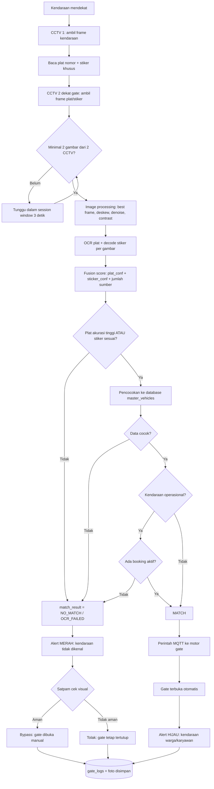
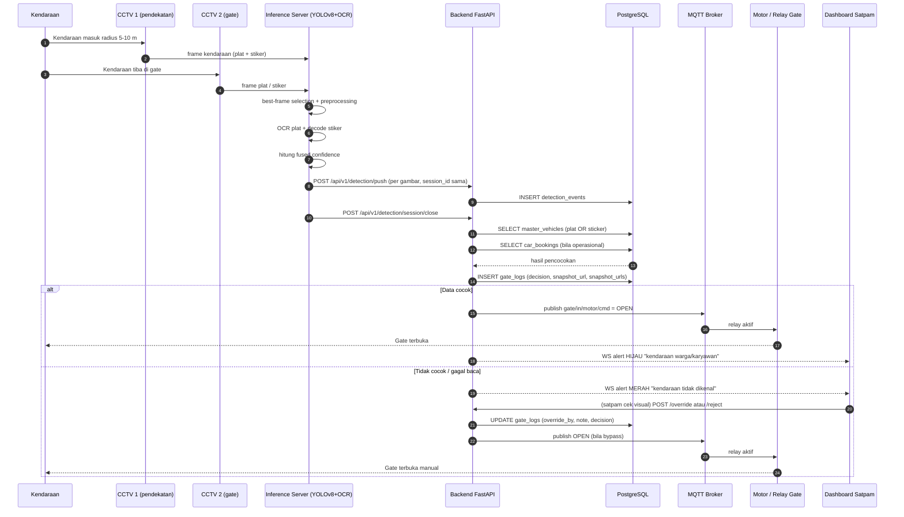
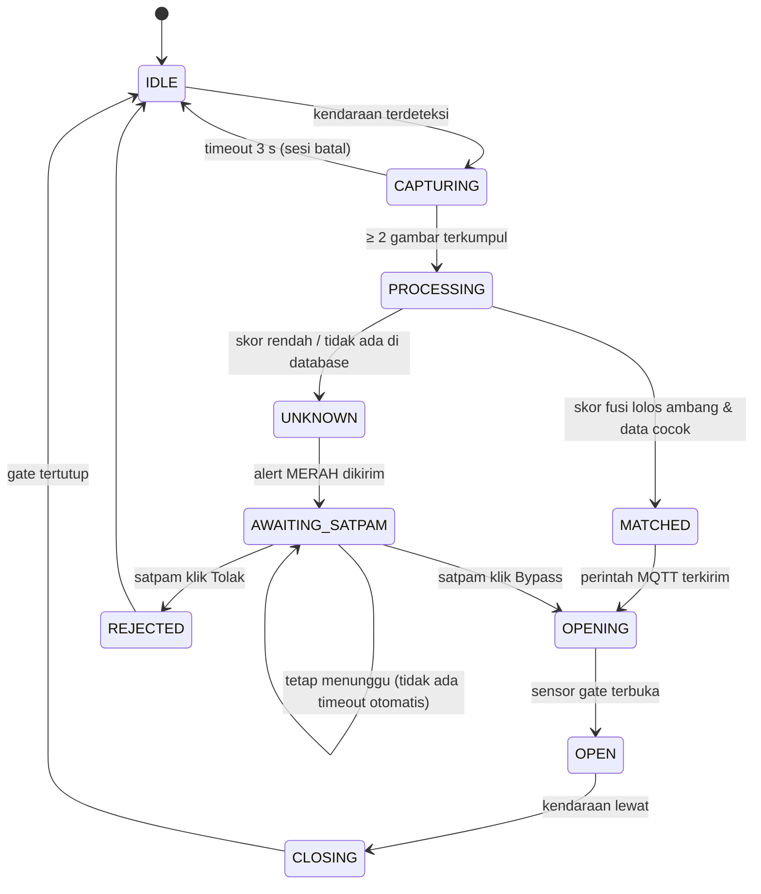
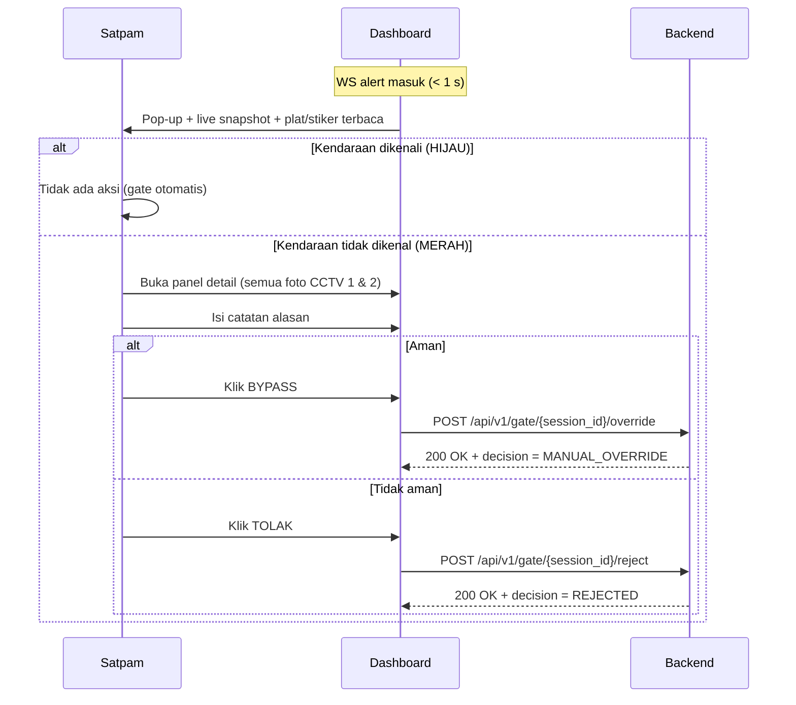

# System Flow — Enterprise Smart Gate System

Referensi: [PRD.md](PRD.md) · [DATABASE.md](DATABASE.md) · [API.md](API.md) · [TECHNICAL.md](TECHNICAL.md)

---

## 1. Alur Utama (High Level)

---

## 2. Sequence Diagram Detail

---

## 3. State Machine Gate

---

## 4. Tabel Keputusan

| Kondisi | Plat | Stiker | Booking | Hasil | Aksi Sistem |
| :--- | :--- | :--- | :--- | :--- | :--- |
| 1 | Cocok, conf ≥ 0.85 | apa pun | tidak perlu | **MATCH** | AUTO_OPEN + alert HIJAU |
| 2 | Gagal / conf rendah | Cocok, conf ≥ 0.80 | tidak perlu | **MATCH** | AUTO_OPEN + alert HIJAU |
| 3 | Cocok | Cocok | tidak perlu | **MATCH** (fusi) | AUTO_OPEN + alert HIJAU |
| 4 | Cocok tapi kendaraan OPERASIONAL | — | tidak ada booking aktif | **NO_MATCH** | alert MERAH + bypass manual |
| 5 | Cocok tapi kendaraan OPERASIONAL | — | ada booking aktif | **MATCH** | AUTO_OPEN + alert HIJAU |
| 6 | Gagal | Gagal | — | **OCR_FAILED** | alert MERAH + bypass manual |
| 7 | Cocok | — | — | tidak terdaftar di DB | **NO_MATCH** | alert MERAH + bypass manual |
| 8 | Apa pun (kendaraan sudah diizinkan satpam) | — | — | **MANUAL_OVERRIDE** | gate dibuka, log + identitas satpam |
| 9 | Apa pun, satpam menilai tidak aman | — | — | **REJECTED** | gate tetap tertutup, log + foto |

Prioritas: baris 4 (booking) dievaluasi **setelah** identitas kendaraan cocok. Stiker berfungsi sebagai penguat/pengganti plat, bukan penurun keputusan.

---

## 5. Timeline Satu Sesi (contoh normal)

```mermaid
gantt
    title Timeline keputusan gate (target ≤ 1.5 s)
    dateFormat X
    axisFormat %L ms
    section CCTV
    CCTV 1 capture           :a1, 0, 120
    CCTV 2 capture           :a2, 120, 180
    section AI
    Best frame + preprocess  :b1, 180, 420
    OCR plat + decode stiker :b2, 420, 800
    Fusion score             :b3, 800, 880
    section Backend
    Match database           :c1, 880, 1060
    Publish MQTT             :c2, 1060, 1180
    WebSocket alert          :c3, 1060, 1260
    section Gate
    Motor relay bergerak     :d1, 1180, 1450
```

---

## 6. Penanganan Kondisi Gagal

| Skenario | Deteksi | Penanganan |
| :--- | :--- | :--- |
| CCTV 1 mati | Heartbeat timeout 30 s | Alert ke admin, sistem tetap lanjut dengan CCTV 2 saja (min 1 gambar), beri flag `degraded_mode` di log |
| CCTV 2 mati | Heartbeat timeout 30 s | Idem — lanjut dengan CCTV 1 saja |
| Inference server mati | Tidak ada response 5 s | Alert admin, semua deteksi masuk mode manual; satpam bypass |
| MQTT broker mati | Publish gagal 3× retry | Fallback HTTP langsung ke ESP32 (`POST /relay/open`); jika gagal → alert HIJAU tetap tampil tapi gate harus dibuka manual |
| Motor tidak merespons | Tidak ada ACK 2 s | Alert dashboard: "gate gagal terbuka otomatis", satpam buka manual via tombol darurat |
| Database tidak tersedia | Query timeout 2 s | Deteksi diperlakukan `NO_MATCH` (fail-safe: **jangan** buka gate otomatis) |
| Plat terbaca ganda (dua kendaraan) | Dua `session_id` overlap | Sesi lama ditutup sebagai `REJECTED`, sesi terbaru diprioritaskan; keduanya tetap dicatat |
| Stiker rusak / tidak terbaca | `sticker_confidence` = 0 | Jalur plat tetap dipakai; tidak memblokir keputusan |

---

## 7. Interaksi Dashboard Satpam

---

## 8. Normalisasi & Korelasi Sesi

1. **Pembuatan `session_id`** — dibuat oleh AI worker saat kendaraan pertama masuk area CCTV 1 (format bebas, contoh UUIDv4).
2. **Korelasi** — semua deteksi dari CCTV 1 dan CCTV 2 dengan `captured_at` dalam jendela ≤ `session_window_seconds` (default 3 s) dan `direction` sama dianggap satu sesi.
3. **Penutupan sesi** — terjadi bila:
   - jumlah gambar ≥ `min_images_per_session` **dan** tidak ada deteksi baru selama 1 detik, atau
   - timeout total 5 detik (dipaksa tutup, diproses dengan gambar yang ada).
4. **Best frame** — dipilih per CCTV dengan skor tertinggi `(plat_confidence + sticker_confidence)`; ditandai `is_best_frame = TRUE`.
5. **Fusi** — `fused_score = max(plat_confidence di semua CCTV) + 0.1 × jumlah_cctv_berhasil`, dibatasi ≤ 1.0. Stiker memberi bobot setara plat (`max(sticker_confidence) + 0.1 × jumlah_cctv_berhasil`); keputusan ambil yang tertinggi.

---

## 9. Skema Prioritas Arah (IN/OUT)

| Arah | CCTV aktif | Aturan |
| :--- | :--- | :--- |
| `IN` | CCTV 1 (approach masuk) + CCTV 2 (gate masuk) | Wajib match di `master_vehicles`; kendaraan operasional wajib booking aktif |
| `OUT` | CCTV gate keluar | Match di `master_vehicles` cukup untuk membuka; booking diverifikasi sebagai penutup sesi kendaraan operasional |

---

## 10. Catatan Implementasi Prototype

Pada prototype Flask saat ini (`Tugas Citra Digital/prototype/`):

- **Gerbang keras aturan NRKB** — hasil OCR yang melanggar struktur (bagian
  depan huruf, nomor tidak diawali `0`) dianggap tidak terbaca; confidence
  tidak ikut `fused_score`, dan alasan `OCR_FAILED` menjelaskan pelanggaran
  format. Voting antar-frame membuang suara yang melanggar struktur.
- **Tolak distraktor** — kandidat diurutkan `candidate_score` (bingkai plat +
  struktur + kedekatan); subtitle/objek video tidak mengambil slot OCR. Blok
  warna fallback stiker yang gagal didekode dibuang, bukan bukti.
- **Efisiensi CPU** — gamma+CLAHE hanya pada ROI deteksi dan crop plat (bukan
  frame penuh); auto scan memakai jalur `fast` (preview, tanpa simpan log),
  unggahan manual & scan-simpan-log selalu jalur penuh.
- **Ketahanan moiré layar** — median blur 3×3 pada enhancement crop, retry
  berbasis keyakinan (< 0,80), dan margin crop OCR dijaga (`pad_crop`) agar
  tepi huruf tidak terpotong.
